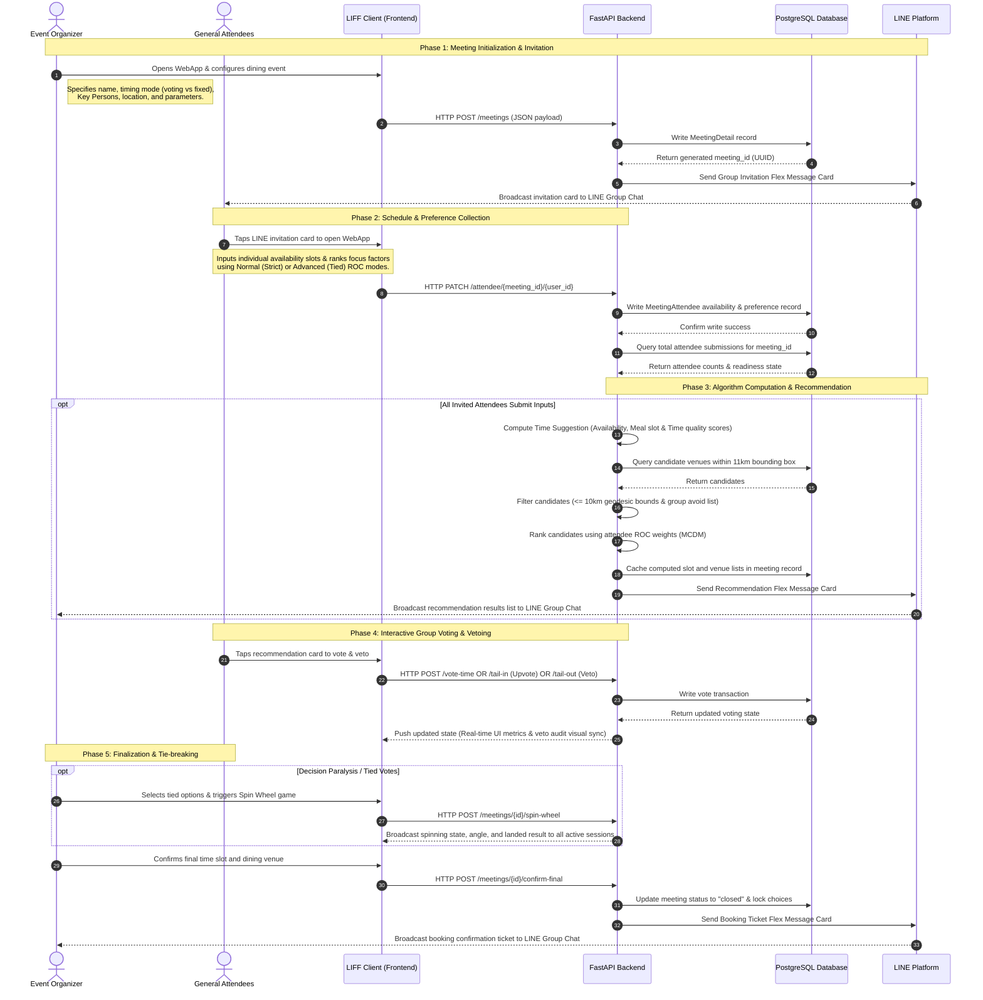

# DISHCISION 🍽️ — Collaborative Group Dining Coordinator

**DISHCISION** is a collaborative group dining coordinator that solves the age-old question: *"Where and when should we eat?"* 

By combining an interactive availability schedule grid, custom MCDM (Multi-Criteria Decision Making) venue ranking, real-time LINE group chat messaging integration, and interactive tie-breaker games, DISHCISION takes the friction out of planning group meals.

---

## 📝 Abstract
---
Commensality plays a crucial role in strengthening social bonds and individual well-being. However, collective decision-making in group dining often faces complexities in reaching a consensus. Based on an empirical study of 74 participants, key barriers include conflicting preferences, budget disparities, and the lack of efficient coordination. 

To address these challenges, this research synthesizes the **"3Rs" framework (Right Time, Right Person, Right Place)** and develops a LINE Chatbot named **"DISHCISION."** Designed as a decision-support tool, DISHCISION facilitates the group's restaurant selection process. The expected benefits include a more convenient and rapid appointment process, specifically in synchronizing member schedules and streamlining restaurant choices. By integrating user preferences with seamless technology, DISHCISION effectively reduces redundancy and transforms cumbersome scheduling into a highly systematic and time-efficient experience.

---

## 💡 The Core Concept & Problem Solved

Planning group dining events is plagued by friction:
1. **Time Coordination**: Endless group chat messages trying to find a slot when everyone is free.
2. **Conflicting Preferences**: Different budgets, dietary constraints, preferred cuisines, vibe preferences, and facility needs (like parking or alcohol).
3. **Decision Paralysis & Vetoes**: People are hesitant to make decisions, but often have strong negative preferences (vetoes).
4. **Weighted Authority**: Sometimes, the organizer or birthday guest ("Key Person") should have more say in the final venue than others.

**DISHCISION** solves these by modeling the coordination as an automated, mathematical optimization problem:
- **Scheduling**: Finds overlapping time windows across custom time ranges.
- **Preferences (MCDM)**: Ranks venues using the **Rank Order Centroid (ROC)** weighting method based on individual priority lists.
- **Social Auditing (Veto Control)**: Allows members to place upvotes (Likes) and vetoes (Dislikes/Vetoes), and transparently displays who vetoed a venue to encourage open discussion rather than anonymous blocker decisions.
- **Authority Weighting**: Allows organizers to dynamically adjust decision weight ratios between Key Decision Makers and General Attendees.

---

## 🔄 The End-to-End Business Flow

### 1. Meeting Initiation
The event Organizer creates a meeting inside the LINE Group chat by defining the event name, timing mode (Voting Range or Fixed Time), inviting group members, and flagging **Key Decision Makers** (whose preferences will carry more weight).

### 2. Preference & Availability Submission
Invitees receive a **LINE Flex Message Card** directly in the group chat. Tapping the card opens the LIFF (LINE Front-end Framework) Webview. Members set their free timeslots and specify individual food preferences (budget, cuisines, avoided cuisines, vibes, parking, and alcohol). **Selecting at least one focus factor is strictly mandatory** to complete submission, which prioritizes the selected criteria in order of importance.

### 3. Suggestions Generation
Once all invitees submit their schedules and preferences, the server executes the suggestion engine:
- It runs the **Time Overlap Algorithm** to identify the best 30-minute intervals.
- It evaluates the local restaurant database against the group's MCDM requirements, ranking options based on ROC calculations.
- It pushes a **Group Suggestion Flex Message** to the LINE chat detailing the top recommendations.

### 4. Interactive Voting & Vetoing
Group members vote on the recommended slots and restaurants (using "Tail In" for upvotes and "Tail Out" for vetoes). If any member vetoes a venue, the UI highlights exactly who vetoed it to prevent silent consensus blocking. The Organizer can choose to filter out vetoed options entirely.

### 5. Resolution & Final Decision
If there is a tie, the Organizer can load the candidates into an interactive **Spin Wheel** game. When spun, the wheel animates on all active screens in real-time. Once the final time and venue are confirmed, DISHCISION locks the meeting and broadcasts the booking ticket to the LINE group.

---

## 🧠 Key MCDM & Suggestion Algorithms

DISHCISION runs two recommendation pipelines: a scheduling engine to locate optimal times, and a Multi-Criteria Decision-Making (MCDM) model to rank dining venues.

For details on the mathematical formulas, overlap weights, Rank Order Centroid (ROC) calculation metrics, and social boost values, please see the [Backend Documentation](file:///Users/pasawee.p/Second%20Brain/1.%20Projects/Restaurant%20Suggestion/dishcision-line-bot/backend/README.md).

---

## 🛠️ Developer & User Setup Guides

- To set up, compile, and deploy this project step-by-step, see [developer_tutorial.md](file:///Users/pasawee.p/Second%20Brain/1.%20Projects/Restaurant%20Suggestion/dishcision-line-bot/developer_tutorial.md) (covers both local development and **secure Docker production deployment on AWS EC2 via Cloudflare Tunnels**).
- To learn how to use this application to plan events as a user, see [tutorials.md](file:///Users/pasawee.p/Second%20Brain/1.%20Projects/Restaurant%20Suggestion/dishcision-line-bot/tutorials.md).
- To configure, add, or modify questions in the beta user survey (which is shown after confirmation when `NEXT_PUBLIC_ENABLE_BETA_SURVEY=true`), edit the [survey-questions.json](file:///Users/pasawee.p/Second%20Brain/1.%20Projects/Restaurant%20Suggestion/dishcision-line-bot/frontend/app/config/survey-questions.json) file.

