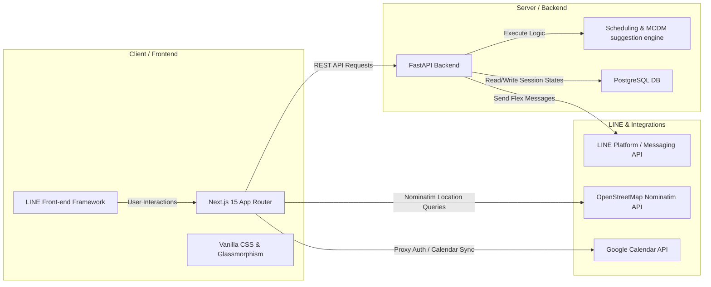

# DISHCISION 🍽️

**DISHCISION** is a collaborative group dining coordinator that solves the age-old question: *"Where and when should we eat?"* By combining an interactive availability schedule grid, custom MCDM (Multi-Criteria Decision Making) venue ranking, real-time LINE group chat messaging integration, and interactive tie-breaker games, DISHCISION takes the friction out of planning group meals.

---

## 🚀 Current Stage & Project Status

The project is currently in the **feature-complete prototype stage**, actively integrating advanced group decision-making policies and live audit traits:

1. **Schedule Grid & Alignment**: Dynamic Thai-Bangkok local timezone scheduler.
2. **MCDM Recommendation Pipeline**: Priority-driven venue ranking using **Rank Order Centroid (ROC)** weighting.
3. **Veto Control & Auditing**:
   - **Veto Auditing**: Reveals exactly which group member placed a veto (`Tail Out`) on a venue to improve communication.
   - **Exclude Vetoed Filter**: Allows organizers to toggle exclusion of all vetoed venues instantly from the final decision list.
4. **Natural Language Highlights**: Dynamic badges (e.g. `👑 Key Choice`, `🚇 Transit Friendly`, `💰 Budget Match`) and natural language summaries of why a restaurant is recommended.
5. **Interactive Tie-Breaker**: Live spin wheel for both timeslots and venues to resolve group ties.
6. **Tunnels Integration**: Cloudflare and ngrok local-tunnel wrappers to test on mobile LINE webviews.

---

## 📁 System Architecture Overview



---

## 🛠️ Running the Application Locally

1. **Start the Frontend**:
   Navigate to the frontend directory and start the development server:
   ```bash
   cd frontend
   npm run dev
   ```

2. **Start the Backend**:
   Navigate to the backend directory and run the main application using `uv`:
   ```bash
   cd backend
   uv run main.py
   ```

3. **Start the Tunnels**:
   Expose your local servers to the public internet using Cloudflare and ngrok. Open separate terminal windows for these:
   
   - **Cloudflare (for Frontend)**:
     ```bash
     ./start-cloudflared.sh
     ```
   - **ngrok (for Backend)**:
     ```bash
     ./start-ngrok.sh
     ```
   *(Ensure you update your LINE Developer Console with the generated public URLs.)*

For detailed setup instructions, including Google OAuth Proxy setup, see [frontend/README.md](file:///Users/pasawee.p/Second%20Brain/1.%20Projects/Restaurant%20Suggestion/dishcision-line-bot/frontend/README.md).
For detailed algorithm equations and endpoint routing schemas, see [backend/README.md](file:///Users/pasawee.p/Second%20Brain/1.%20Projects/Restaurant%20Suggestion/dishcision-line-bot/backend/README.md).
