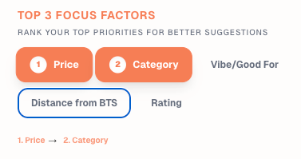

# Technical Report: Dynamic Multi-Criteria Scoring for Collaborative Decision Support

## 1. Abstract
This document outlines the **Dynamic Multi-Criteria Decision Making (MCDM)** framework implemented in the Dishcision recommendation engine. The system utilizes a weighted voting algorithm that dynamically adjusts the importance of decision criteria based on individual participant priorities. This approach ensures that group suggestions are not only mathematically optimal but also align with the qualitative preferences of the stakeholders.

### 1.1 Visual Interface
The following interface demonstrates the participant ranking mechanism used to collect qualitative focus data:

---

## 2. Decision Logic Overview

### 2.1 Participant Input Mechanism
During the data collection phase (Meeting Creation or Voting), each participant $i$ selects and ranks their top $k$ focus factors (where $k=3$). These rankings are transformed into numerical "Priority Points" ($P$) to represent the relative intensity of their preference:

| Ranking ($r$) | Priority Points ($P_{i,A}$) | Qualitative Description |
| :--- | :--- | :--- |
| **Rank 1** | **5** | Primary Decision Driver |
| **Rank 2** | **3** | Secondary Consideration |
| **Rank 3** | **1** | Tertiary Preference |
| **Unranked** | **0** | Base Consideration Only |

### 2.2 Dynamic Max-Weight Calculation
The maximum point capacity ($Max_A$) for each attribute $A$ is recalculated per meeting instance. This transformation shifts the center of gravity of the scoring model toward the group's collective focus.

The final weight for attribute $A$ is defined as:
$$Max_A = BaseMax_A + \left( \frac{\sum_{i=1}^{n} P_{i,A}}{n} \right)$$

Where:
*   $n$ = Total number of attendees.
*   $BaseMax_A$ = The static structural weight of the attribute (e.g., 10 for Price).
*   $P_{i,A}$ = Priority points assigned to attribute $A$ by participant $i$.

---

## 3. Comparative Weight Analysis (Category Base = 10)

The following table demonstrates the sensitivity of the model to participant agreement. It compares the **Base Ratio** (initial state) against the **Boosted Ratio** (unanimous agreement on a specific factor).

| Attribute ($A$) | Base Max | Max Boost | **Dynamic Max** | **Baseline Ratio** | **Full Boost Ratio** |
| :--- | :--- | :--- | :--- | :--- | :--- |
| **Category** | 10 | +5 | **15** | 20.0% | **25.4%** |
| **Price** | 10 | +5 | **15** | 20.0% | **25.4%** |
| **Vibe / Environment** | 10 | +5 | **15** | 20.0% | **25.4%** |
| **Proximity (BTS)** | 5 | +5 | **10** | 10.0% | **16.9%** |
| **Wongnai Rating** | 5 | +5 | **10** | 10.0% | **16.9%** |
| **Ancillary (Parking/Alc)**| 10 | +0 | **10** | 20.0% | 16.9% |

---

## 4. Final Aggregation and Normalization

To ensure comparability across varied meeting configurations, the accumulated points ($S$) for each candidate restaurant are normalized to a standard score ($X \in [0, 100]$):

$$X = \left( \frac{\sum_{A=1}^{m} S_A}{\sum_{A=1}^{m} Max_A} \right) \times 100$$

Where $m$ is the total number of active criteria (including conditional factors like **Manual Suggestions**).

---

## 5. Case Study Simulations

### Case 1: Perfect Consensus (No Suggestions)
*Participants agreement on Price (1st), Category (2nd), and Vibe (3rd).*

| Attribute | Base | Boost | Final Max | Ratio (Standard) | Ratio (Boosted) |
| :--- | :--- | :--- | :--- | :--- | :--- |
| **Category** | 10.0 | +3.0 | 13.0 | 20.0% | **22.0%** |
| **Price** | 10.0 | +5.0 | 15.0 | 20.0% | **25.4%** |
| **Vibe** | 10.0 | +1.0 | 11.0 | 20.0% | **18.6%** |
| Others | 5.0 | 0.0 | 5.0 | 10.0% | 8.5% |
| **TOTAL** | | | **59.0** | 100% | 100% |

### Case 2: Shared Factors, Different Ranks (No Suggestions)
*Participants pick same factors but disagree on priority order.*

| Attribute | Base | Boost | Final Max | Ratio (Standard) | Ratio (Boosted) |
| :--- | :--- | :--- | :--- | :--- | :--- |
| **Price / Cat / Vibe** | 10.0 | +3.0 | 13.0 | 20.0% | **22.0%** |
| Others | 5.0 | 0.0 | 5.0 | 10.0% | 8.5% |
| **TOTAL** | | | **59.0** | 100% | 100% |

### Case 3: Maximum Entropy / Neutral State (No Suggestions)
*Priorities are uniformly distributed across all 5 possible priority factors.*

| Attribute | Base | Boost | Final Max | Ratio (Standard) | Ratio (Boosted) |
| :--- | :--- | :--- | :--- | :--- | :--- |
| **Price / Cat / Vibe** | 10.0 | +1.8 | 11.8 | 20.0% | **20.0%** |
| **Dist / Rating** | 5.0 | +1.8 | 6.8 | 10.0% | **11.5%** |
| Others | 5.0 | 0.0 | 5.0 | 10.0% | 8.5% |
| **TOTAL** | | | **59.0** | 100% | 100% |

---

### Case 4: Unanimous Primary Focus with Social Input
*Consensus on a single driver (Price) combined with manual restaurant suggestions.*

| Attribute | Base | Boost | Final Max | Ratio (Standard) | Ratio (Boosted) |
| :--- | :--- | :--- | :--- | :--- | :--- |
| **Price** | 10.0 | +5.0 | 15.0 | 15.4% | **20.3%** |
| **Suggestion** | 15.0 | 0.0 | 15.0 | 23.1% | **20.3%** |
| **Category** | 10.0 | 0.0 | 10.0 | 15.4% | 13.5% |
| Others | 5.0 | 0.0 | 5.0 | 7.7% | 6.8% |
| **TOTAL** | | | **74.0** | 100% | 100% |

### Case 5: Multi-Criteria Compromise with Social Input
*Distributed ranking (Case 2) integrated with manual restaurant suggestions.*

| Attribute | Base | Boost | Final Max | Ratio (Standard) | Ratio (Boosted) |
| :--- | :--- | :--- | :--- | :--- | :--- |
| **Suggestion** | 15.0 | 0.0 | 15.0 | 23.1% | **20.3%** |
| **Price / Cat / Vibe** | 10.0 | +3.0 | 13.0 | 15.4% | **17.6%** |
| Others | 5.0 | 0.0 | 5.0 | 7.7% | 6.8% |
| **TOTAL** | | | **74.0** | 100% | 100% |

### Case 6: Recommendation-Driven Decision (Social Input)
*Neutral split (Case 3) where social input acts as the primary tie-breaker.*

| Attribute | Base | Boost | Final Max | Ratio (Standard) | Ratio (Boosted) |
| :--- | :--- | :--- | :--- | :--- | :--- |
| **Suggestion** | 15.0 | 0.0 | 15.0 | 23.1% | **20.3%** |
| **Price / Cat / Vibe** | 10.0 | +1.8 | 11.8 | 15.4% | **15.9%** |
| **Dist / Rating** | 5.0 | +1.8 | 6.8 | 7.7% | **9.2%** |
| Others | 5.0 | 0.0 | 5.0 | 7.7% | 6.8% |
| **TOTAL** | | | **74.0** | 100% | 100% |

---

## 6. Conclusion
The Dynamic MCDM framework provides a robust, self-adjusting mechanism for group restaurant suggestions. By shifting the mathematical weights in response to qualitative user input, the system effectively bridges the gap between raw data analysis and human preference.
