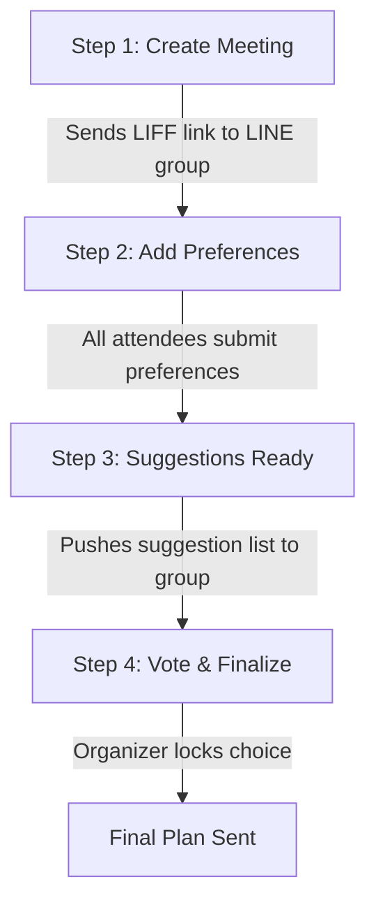

# DISHCISION Frontend Documentation

This directory contains the source code for the **DISHCISION** client web application. The frontend is built using **Next.js 15 (App Router)** and styled using pure, premium **Vanilla CSS** with glassmorphism effects for maximum control, performance, and responsive layout.

---

## 1. User Experience (UX) Flow

The application utilizes a step-by-step collaborative flow integrated directly into LINE via the LINE Front-end Framework (LIFF).

### 📊 Step-by-Step Flow:
1. **Step 1: Create Meeting (Organizer)**
   - The meeting organizer navigates to `/create-meeting` inside LIFF or a browser.
   - They specify details: meeting name, date options, meal time selection, location preference, and invite attendees (assigning *Key Persons* and *General Attendees*).
   - Once submitted, a LINE Flex message is sent to the LINE group with an invitation link.
2. **Step 2: Add Preferences (Attendees)**
   - Group members click **"Add Preferences"** on the LINE Flex card, opening `/availability`.
   - The user inputs:
     - **Availability Grid**: Selects times they are free on a weekly/calendar layout.
     - **Preferences & Vetoes**: Customizes cuisines, vibes, budget tier, parking requirements, and alcohol options.
     - **Avoid categories**: Selects cuisines they want to explicitly filter out.
     - **Priority Focus**: Ranks their top 3 drivers (e.g. Price as Rank 1, Vibe as Rank 2, MRT station proximity as Rank 3).
   - On submission, attendee data is updated. Once all invitees submit, the backend suggestion pipeline fires.
3. **Step 3: Suggestions Ready (Notification)**
   - The system computes optimal scheduling windows and ranks venues, pushing a Flex Carousel card directly to the LINE group chat showing top matching slots and restaurants.
4. **Step 4: Vote & Finalize (Decision Phase)**
   - Attendees click **"See Suggestions & Vote"**, opening `/result`.
   - They land on the **Decision** tab, which guides them through the voting process:
     - **Slots Tab**: Vote on preferred time slots.
     - **Restaurants Tab**: Upvote ("Tail In") preferred venues, or veto ("Tail Out") undesired ones.
     - **Decision Tab**: Real-time summary showing vote counts, user ready checks, and a live spin-wheel utility for tie-breakers.
   - Once consensus is reached (or the organizer makes a choice), the organizer clicks **"Lock Decision"**. The meeting closes and a final event ticket with confirmed details is pushed to the group chat.

---

## 2. Page Directory & Descriptions

The frontend application consists of **5 main pages or view contexts**:

### 1. Home / Landing Page (`/`)
- **Purpose**: Brand entry-point showing logo, description, and redirection routes.
- **Features**: Ambient animated background glows, responsive styling, and a link to the Algorithm Playground sandbox.

### 2. Algorithm Playground Sandbox (`/playground`)
- **Purpose**: Dev-only sandbox to evaluate and test scheduling and restaurant recommendation models.
- **Features**: Allows tweaking parameters (attendant inputs, key weights, criteria) to preview immediate scoring output and validation heuristics.

### 3. Create Meeting (`/create-meeting`)
- **Purpose**: The event creation dashboard.
- **Key Sections**:
  - **Basic Info**: Name and timing mode: *Period* (date range + meal choice) or *Fixed* (specific date + times).
  - **Location settings**: Search and select location boundaries via the Nominatim OpenStreetMap proxy.
  - **Attendee setup**: List names and toggle who acts as a *Key Person* (whose vote is weighted higher, e.g., 70%).
  - **Decision settings**: Toggle options like `requireAllJoin` or `allowOthersSuggest`.

### 4. Availability Form (`/availability`)
- **Purpose**: Collect attendee calendar grids and MCDM preferences.
- **Key Sections**:
  - **Status Switcher**: Toggle between "Join Meeting" and "Cannot Join".
  - **Interactive Schedule Grid**: Desktop/mobile responsive scheduler that lets users tap/drag 30-minute time intervals to indicate availability.
  - **Preferences & Vetoes**: Sets price scale, preferred cuisines, vibes, parking/alcohol criteria.
  - **Priorities Booster Interface**: A drag-and-drop or select interface where users rank their top 3 priorities out of Price, Category, Vibe, BTS Station, Rating, Parking, and Alcohol.
  - **Bypass simulation console**: A dev tool to choose an attendee and fill preferences on their behalf, bypassing LIFF authentication.

### 5. Results & Group Dashboard (`/result`)
This route handles two layout modes:
- **A. Meeting Results View** (when loaded with `meeting_id` parameter):
  - **Slots Tab**: Lists time slots sorted by scoring. Highlights full joins, partial joins (with overlap minutes), and allows toggling personal votes.
  - **Restaurants Tab**: Displays matching restaurants. It features a sub-tab bar showing **Friends** (manually recommended by attendees) and **Suggested** (system-ranked venues nearby) with full address, price scale, ratings, and tag summaries.
  - **Decision Tab**:
    - Displays a **Guidance Banner** prompting users to vote in Slots/Restaurants if they haven't yet.
    - Lists real-time time/restaurant voting tallies.
    - Shows list of attendees and their "Ready" state checks.
    - **Spin Wheel Panel**: Allows the organizer to choose a tie-breaker wheel for slots or restaurants, select candidates, spin, and automatically populate the winner.
    - **Lock Decision Action**: For organizers to submit confirmed parameters and close voting.
- **B. Group Dashboard View** (when loaded with `group_id` parameter only):
  - Lists all meetings created within that LINE group.
  - Displays dates, status badges (**Vote Now** / **Closed**), and provides direct links to the meeting result pages.
