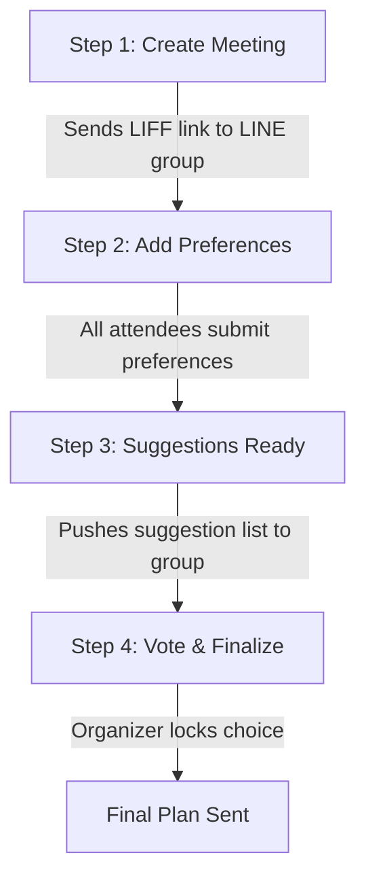

# DISHCISION Frontend Documentation

This directory contains the source code for the **DISHCISION** client web application. The frontend is built using **Next.js 15 (App Router)** and styled using pure, premium **Vanilla CSS** with glassmorphism effects for maximum control, performance, and responsive layout.

---

## 1. User Experience (UX) Flow

The application utilizes a step-by-step collaborative flow integrated directly into LINE via the LINE Front-end Framework (LIFF).



### 📊 Step-by-Step Flow:
1. **Step 1: Create Meeting (Organizer)**
   - The meeting organizer navigates to `/create-meeting` inside LIFF or a browser.
   - They specify details: meeting name, date options, meal time selection, location preference, and invite attendees (assigning *Key Persons* and *General Attendees*).
   - Once submitted, a LINE Flex message is sent to the LINE group with an invitation link.
2. **Step 2: Add Preferences (Attendees)**
   - Group members click **"Add Preferences"** on the LINE Flex card, opening `/availability`.
   - The user inputs:
     - **Availability Grid**: Selects times they are free on a weekly/calendar layout.
     - **Preferences & Vetoes**: Customizes cuisines, vibes, budget tier, parking requirements, and alcohol options.
     - **Avoid categories**: Selects cuisines they want to explicitly filter out.
     - **Priority Focus**: Ranks their top 3 drivers (e.g. Price as Rank 1, Vibe as Rank 2, MRT station proximity as Rank 3).
   - On submission, attendee data is updated. Once all invitees submit, the backend suggestion pipeline fires.
3. **Step 3: Suggestions Ready (Notification)**
   - The system computes optimal scheduling windows and ranks venues, pushing a Flex Carousel card directly to the LINE group chat showing top matching slots and restaurants.
4. **Step 4: Vote & Finalize (Decision Phase)**
   - Attendees click **"See Suggestions & Vote"**, opening `/result`.
   - They land on the **Decision** tab, which guides them through the voting process:
     - **Slots Tab**: Vote on preferred time slots.
     - **Restaurants Tab**: Upvote ("Tail In") preferred venues, or veto ("Tail Out") undesired ones.
     - **Decision Tab**: Real-time summary showing vote counts, user ready checks, and a live spin-wheel utility for tie-breakers.
   - Once consensus is reached (or the organizer makes a choice), the organizer clicks **"Lock Decision"**. The meeting closes and a final event ticket with confirmed details is pushed to the group chat.

---

## 2. Page Directory & Descriptions

The frontend application consists of **5 main pages or view contexts**:

### 1. Home / Landing Page (`/`)
- **Purpose**: Brand entry-point showing logo, description, and redirection routes.
- **Features**: Ambient animated background glows, responsive styling, and a link to the Algorithm Playground sandbox.

### 2. Algorithm Playground Sandbox (`/playground`)
- **Purpose**: Dev-only sandbox to evaluate and test scheduling and restaurant recommendation models.
- **Features**: Allows tweaking parameters (attendant inputs, key weights, criteria) to preview immediate scoring output and validation heuristics.

### 3. Create Meeting (`/create-meeting`)
- **Purpose**: The event creation dashboard.
- **Key Sections**:
  - **Basic Info**: Name and timing mode: *Period* (date range + meal choice) or *Fixed* (specific date + times).
  - **Location settings**: Search and select location boundaries via the Nominatim OpenStreetMap proxy.
  - **Attendee setup**: List names and toggle who acts as a *Key Person* (whose vote is weighted higher, e.g., 70%).
  - **Decision settings**: Toggle options like `requireAllJoin` or `allowOthersSuggest`.

### 4. Availability Form (`/availability`)
- **Purpose**: Collect attendee calendar grids and MCDM preferences.
- **Key Sections**:
  - **Status Switcher**: Toggle between "Join Meeting" and "Cannot Join".
  - **Interactive Schedule Grid**: Desktop/mobile responsive scheduler that lets users tap/drag 30-minute time intervals to indicate availability.
  - **Preferences & Vetoes**: Sets price scale, preferred cuisines, vibes, parking/alcohol criteria.
  - **Priorities Booster Interface**: A drag-and-drop or select interface where users rank their focus factors (Price, Category, Vibe, BTS Station, Rating, Parking, and Alcohol) using either **Normal Mode** (strict ranking) or **Advanced Mode** (tied/grouped ranking).
  - **Priorities Validation**: Both organizers and attendees are strictly required to select at least one priority focus factor before submitting their forms to prevent unranked fallback states.
  - **Bypass simulation console**: A dev tool to choose an attendee and fill preferences on their behalf, bypassing LIFF authentication.

### 5. Results & Group Dashboard (`/result`)
This route handles two layout modes:
- **A. Meeting Results View** (when loaded with `meeting_id` parameter):
  - **Slots Tab**: Lists time slots sorted by scoring. Highlights full joins, partial joins (with overlap minutes), and allows toggling personal votes.
  - **Restaurants Tab**: Displays matching restaurants (both **Friends** recommendations and system-ranked **Suggested** venues nearby) with the following features:
    - **Geodistance Metric**: Displays the precise distance (in km) of the restaurant from the meeting's coordinates.
    - **Veto Auditing**: Lists the exact display names of all attendees who placed a veto (`Tail Out`) on each restaurant.
    - **Algorithmic Highlight Badges**: Displays tags (e.g. `👑 Key Choice`, `💰 Budget Match`, `🚇 Transit Friendly`, `🚗 Parking`, `🍻 Drinks`, `✨ Good Vibe`) calculated from the MCDM scores.
    - **Recommendation Summary**: Formulates a natural language explanation (for the top venue candidate) outlining which group criteria matched.
  - **Decision Tab**:
    - Displays a **Guidance Banner** prompting users to vote in Slots/Restaurants if they haven't yet.
    - Lists real-time time/restaurant voting tallies.
    - Shows list of attendees and their "Ready" state checks.
    - **Veto Filtering Toggle**: Organizer can check *"Exclude Vetoed Restaurants (Tail Out)"* to filter out all vetoed venues from the active selections. Non-organizers receive an information indicator warning them that vetoes have been excluded.
    - **Spin Wheel Panel**: Allows the organizer to choose a tie-breaker wheel for slots or restaurants, select candidates, spin, and automatically populate the winner.
    - **Lock Decision Action**: For organizers to submit confirmed parameters and close voting.
- **B. Group Dashboard View** (when loaded with `group_id` parameter only):
  - Lists all meetings created within that LINE group.
  - Displays dates, status badges (**Vote Now** / **Closed**), and provides direct links to the meeting result pages.


---

## 3. Setup & Environment Variables

Copy `.env.local.example` or create a `.env.local` file inside the `frontend` folder with the following variables:

```env
NEXT_PUBLIC_LIFF_ID=your-liff-id
NEXT_PUBLIC_GOOGLE_CLIENT_ID=your-google-client-id.apps.googleusercontent.com
NEXT_PUBLIC_GOOGLE_AUTH_PROXY_URL=https://your-username.github.io/dishcision-auth/
```

### 🔑 Google Calendar Client ID Setup:
To enable the **Sync Calendar** feature on the availability page, you must register a Web OAuth Client ID:
1. Open the [Google Cloud Console](https://console.cloud.google.com/).
2. Select your project or click **New Project** to create one.
3. Configure the **OAuth Consent Screen** (under **APIs & Services > OAuth consent screen**):
   - Choose **External** user type.
   - Fill in app metadata (Name, User support email, developer contact email).
   - In the **Scopes** section, add the `.../auth/calendar.readonly` (Google Calendar API Read-Only) scope.
4. Create **Credentials** (under **APIs & Services > Credentials**):
   - Click **+ Create Credentials** > **OAuth client ID**.
   - Set the Application type to **Web application**.
   - Under **Authorized JavaScript origins**, click **+ Add URI** and register your domain URL. *Crucial for security; Google blocks requests from unregistered origins.* Add:
     - `http://localhost:3000` (Local dev)
     - `http://localhost:3001` (Production frontend port)
     - The custom domain of your free OAuth Proxy page (e.g., `https://your-username.github.io` if using GitHub Pages, or `https://*.vercel.app` if using Vercel).
     - *Note*: If you are testing on localhost, you do not need the proxy. If you are testing inside LINE on Android/iOS via a Cloudflare Tunnel (`*.trycloudflare.com`), Google blocks the direct origin, so registering the proxy URL is required.
    - Under **Authorized redirect URIs**, click **+ Add URI** and add:
      - `https://your-username.github.io/dishcision-auth/` (Your exact GitHub Pages URL)
5. Click **Create** and copy your **Client ID** string.
6. Paste the string as the value for `NEXT_PUBLIC_GOOGLE_CLIENT_ID` in your `frontend/.env.local` file.
7. Restart your Next.js server to register the environment variable.

### 🌐 Google OAuth Proxy Setup (For Cloudflare Tunnels & LINE webview):
Since Google OAuth blocks JavaScript origins using shared tunnel domains like `trycloudflare.com`, and Android's LINE webview doesn't render Ngrok's interstitial warning page, we use a lightweight static HTML proxy hosted on a free provider (GitHub Pages or Vercel) which Google fully trusts.

#### Step 1: Create a GitHub Pages Repository
1. Create a new public repository on GitHub called `dishcision-auth`.
2. Add an `index.html` file to the root of the repository with the following code:
   ```html
   <!DOCTYPE html>
   <html>
   <head>
     <title>Google Authentication</title>
   </head>
   <body>
     <div style="text-align: center; margin-top: 50px; font-family: sans-serif;">
       <h3>Connecting to Google...</h3>
       <p>Please wait while we redirect you to the Google consent screen.</p>
     </div>
     <script>
       // 1. Check if we just loaded or if we are returning from Google redirect
       const hash = window.location.hash;
       const searchParams = new URLSearchParams(window.location.search);
       
       if (hash && hash.includes('access_token')) {
         // Returning from Google redirect!
         const hashParams = new URLSearchParams(hash.substring(1)); // strip '#'
         const accessToken = hashParams.get('access_token');
         const targetOrigin = searchParams.get('state');
         
         if (window.opener) {
           window.opener.postMessage({ access_token: accessToken }, targetOrigin);
         } else {
           document.body.innerHTML = "<h3>Authentication completed. You can close this window.</h3>";
         }
         window.close();
       } else {
         // First load: Redirect to Google OAuth!
         const origin = searchParams.get('origin');
         const clientId = searchParams.get('client_id');
         
         if (!origin || !clientId) {
           document.body.innerHTML = "<h3>Error: Missing origin or client_id parameters.</h3>";
         } else {
           const redirectUri = window.location.origin + window.location.pathname;
           const googleAuthUrl = `https://accounts.google.com/o/oauth2/v2/auth?` +
             `client_id=${encodeURIComponent(clientId)}&` +
             `redirect_uri=${encodeURIComponent(redirectUri)}&` +
             `response_type=token&` +
             `scope=https://www.googleapis.com/auth/calendar.readonly&` +
             `state=${encodeURIComponent(origin)}`;
             
           window.location.href = googleAuthUrl;
         }
       }
     </script>
   </body>
   </html>
   ```
3. Enable **GitHub Pages** under **Settings > Pages** in your repository, selecting the `main` branch root as the source.
4. Note your GitHub Pages URL (e.g. `https://your-username.github.io/dishcision-auth/`).

#### Step 2: Configure your Environment
1. Add your Pages URL to your `frontend/.env.local` file:
   ```env
   NEXT_PUBLIC_GOOGLE_AUTH_PROXY_URL=https://your-username.github.io/dishcision-auth/
   ```
2. Restart your Next.js frontend server. Now, when running on external tunnels, the app will automatically route calendar sync requests through this secure proxy, allowing your friends on mobile devices (Android & iOS) to sync their Google Calendars cleanly inside the LINE app.


